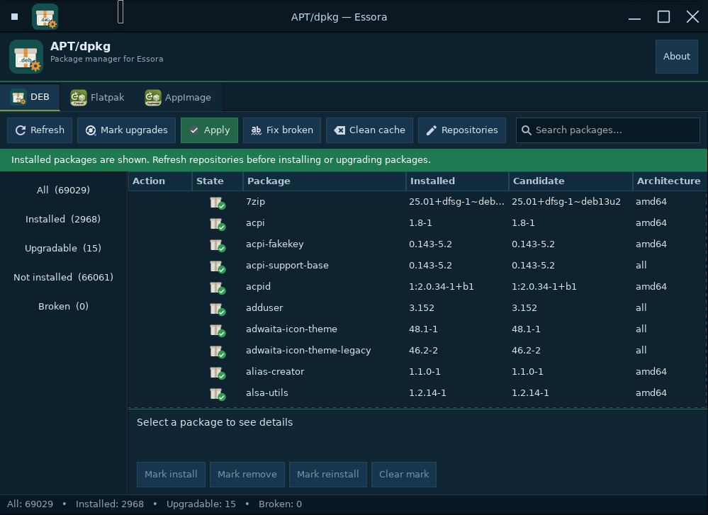
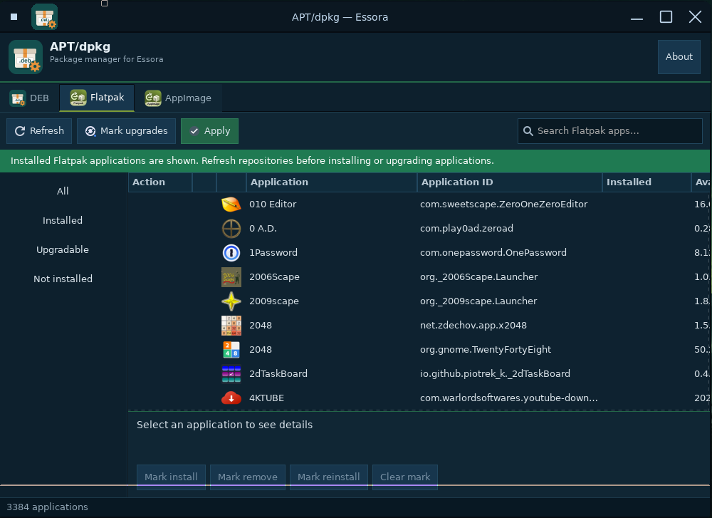
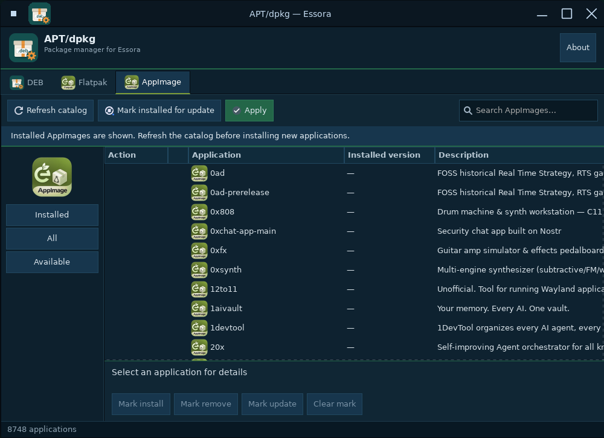

# EDPKG GUI

A lightweight  GTK3 package manager for Essora GNU/Linux  with three separate tabs for  DEB ,  Flatpak  and  AppImage . It brings package browsing, installation, removal and updates into one interface, while keeping each backend independent.

 Essora Project  — *Freedom to Create. Freedom to Explore.*

## Features

### DEB — APT/dpkg or EDPKG

- Automatically uses  EDPKG  when available, falling back to  APT/dpkg  on compatible systems.
- Browse installed, available, upgradable and broken packages; search, select multiple packages and apply changes.
- Refresh package repositories, repair broken packages, manage repositories and clean the package cache.
- Simulate transactions before applying changes, with safeguards for protected kernel packages.
- Clearly distinguish installed packages (green) and packages with available updates (orange).

### Flatpak

- Browse and search Flatpak applications, including their names, application IDs and artwork.
- View installed and upgradable applications; install, remove, reinstall and update selected items.
- Refresh Flatpak/Flathub metadata on demand, with local indexing and caching.
- Use the same installed/upgradable indicators as the DEB tab.

### AppImage

- Browse the  AM Application Manager catalogue  and search applications without installing AM separately.
- Install, update and remove AppImages through an  integrated, adapted AM 10.6 engine .
- Display Essora's AppImage icon beside each catalogue entry and a green indicator for confirmed installed applications.
- Generate launchers in `/usr/share/applications/` for compatibility with Essora's PyMenu, with optional `fixmenus` refresh after transactions.
- Keep installed AppImages in their engine-managed locations under `/opt` so their update and removal scripts remain consistent.
- Load the local catalogue on opening the tab; network refresh occurs only when requested.

 AppImage note:  AM's catalogue includes third-party install recipes. Some recipes need interactive input and may not work in the GUI. Recipes can run with administrative privileges; only install applications from sources you trust. An AppImage's presence in the catalogue is not a guarantee that its installation recipe will succeed.

## Screenshots

### DEB



### Flatpak



### AppImage



*Screenshots show the 0.1.40 interface supplied for this release. The AppImage rows in the updated source also include the generic Essora AppImage icon.*

## Build and installation

Requires a C compiler, `make`, `pkg-config` and the  GTK3 development headers . Build on an Essora, Debian or Devuan system with the required tools installed.

```bash
make
```

To generate a Debian package:

```bash
./build-deb.sh
```

The `.deb` is written to `dist/`. The package's runtime dependency list is defined in `build-deb.sh`; the installed application uses `/usr/lib/edpkg-gui/` for its executable, resources and bundled AppImage engine. The graphical launcher is `edpkg-gui`.

To run source checks after building:

```bash
make check
```

The status-icon source check can also run without GTK3 headers:

```bash
make check-state-icons
```

## Package backend notes

On systems without `/usr/bin/edpkg`, the DEB backend uses `apt-get` for package operations, reads available metadata through `apt-cache dumpavail` and local APT indexes, and can recover interrupted dpkg configuration through `dpkg --configure -a` as part of the repair workflow. When EDPKG is available, it uses the native EDPKG backend rather than applying APT rules to Essora-only packages.

## Design and performance

- Local package information is available without a mandatory network request at GUI startup.
- Flatpak and AppImage catalogue data are cached, with explicit refresh controls.
- GTK3 interface, searchable lists, progress output and batch selection.
- Application resources are loaded once and reused where practical; AppImage's generic row icon is not decoded separately for thousands of entries.
- Translated interface strings for English, Spanish, Portuguese, French, German, Italian, Catalan, Hungarian, Russian, Arabic, Japanese and Chinese.

## Project structure

| Path | Contents |
| --- | --- |
| `src/` | GTK3 interface and three backend pages |
| `data/` | Essora icons, `.desktop` launcher and integration helpers |
| `translations/` | AppImage translations |
| `third_party/am-10.6/` | Modified AM AppImage engine, license and attribution |
| `screenshot/` | Screenshots of DEB, Flatpak and AppImage |
| `tests/` | Regression and integration checks |
| `build-deb.sh` | Debian package builder |

## License and acknowledgments

 EDPKG GUI is distributed under GNU GPL-3.0.  See [`LICENSE`](LICENSE).

The bundled AppImage backend is  based on AM Application Manager 10.6 , created by  Ivan (ivan-hc) . Thank you to Ivan for his work on AM and its community application catalogue. The engine has been modified for Essora and is  not an official AM release or an endorsement by its author .

- Upstream: [ivan-hc/AM](https://github.com/ivan-hc/AM)
- Adapted engine sources and license: [`third_party/am-10.6/`](third_party/am-10.6/)
- Modifications and attribution: [`third_party/am-10.6/ATTRIBUTION.md`](third_party/am-10.6/ATTRIBUTION.md)
- Integration notes and limitations: [`README-APPIMAGE-ENGINE.md`](README-APPIMAGE-ENGINE.md)

When distributing a compiled package, preserve the GPL-3.0 notices and make the corresponding source, including the modified AM components, available under the required license terms.

---

 Essora Project  — *Freedom to Create. Freedom to Explore.*
